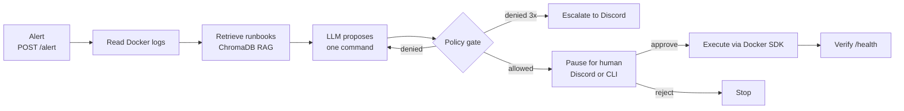

# Autonomous SRE Agent

An AI on-call engineer that runs entirely on your own machine. When a service goes down, it reads the container's logs, finds the matching runbook, proposes a fix, checks the fix against a written company policy, and **asks a human for approval** before running anything. After the fix, it confirms the service is healthy again.

Everything is local and free: the LLM runs in [Ollama](https://ollama.com) (`qwen2.5-coder:3b`), the vector search in ChromaDB, and the orchestration in LangGraph. No paid or external AI APIs are used.

## How it works



1. **Alert**: a monitoring webhook hits `POST /alert` with the failing service name.
2. **Investigate**: the agent reads the container's recent Docker logs.
3. **Retrieve**: it searches local runbooks using the alert and the log lines (RAG over ChromaDB).
4. **Plan**: Ollama proposes one action: `RESTART`, `PAUSE`/`UNPAUSE`, or an `EXEC` command inside the container (for example, a diagnostic `tail -n 50 /var/log/app.log`, or `rm -rf /tmp/cache` to clear a full cache).
5. **Policy gate**: the command is checked against `policies/company_policy.md`. If it's denied, the model is told "not allowed, propose something safe" and gets up to 3 tries. After that, the incident is escalated to a human on Discord.
6. **Human approval**: allowed commands pause the workflow (LangGraph `interrupt_before`). The on-call person gets a Discord message with Approve/Reject buttons, or a prompt in the CLI.
7. **Execute and verify**: the approved command runs through the Docker SDK with a timeout. The agent then checks the service's `/health` endpoint. Diagnostic output is fed back into the next planning step, so it can diagnose first and fix second.

## Safety layers

An LLM never gets to run a command just because it said so. Each layer is independent:

| Layer | What it does | Enforced by |
|---|---|---|
| Static allowlist | Only known programs, flags and paths. `EXEC` is limited to read-only diagnostics and `rm` strictly below `/tmp/`. `STOP` and shell metacharacters are always refused. | Code |
| Managed-target check | The agent may only touch containers listed in `MANAGED_CONTAINERS`, resolved through the Docker SDK so aliases can't slip through. | Code |
| Policy RAG + LLM judge | Relevant clauses from the company policy are retrieved, and a local LLM judges the command against them. The code tells the judge which rule the command already passed. | LLM (advisory) |
| Human approval | Nothing runs until a person approves. Approvals use POST and a one-time token, so link previewers and crawlers can't trigger them. | Code + human |
| Re-check at execution | The allowlist is checked again right before execution, and the approval endpoints refuse threads that never passed the gate. | Code |

The small local judge is a second opinion, not the enforcement mechanism. The hard guarantees come from the code checks and the human approval. See [docs/WORKFLOW.md](docs/WORKFLOW.md#company-policy-gate) for details.

## Tech stack

Python · FastAPI · LangGraph (SQLite checkpointer) · LangChain · Ollama · ChromaDB + HuggingFace embeddings · Docker SDK · Discord webhooks · pytest

## Quick start

Requirements: Python 3.11+, Docker, and [Ollama](https://ollama.com).

```bash
python -m venv venv && venv/Scripts/activate      # Windows; use venv/bin/activate on Linux/macOS
pip install -r requirements.txt
cp .env.example .env                               # then fill in DISCORD_WEBHOOK_URL and BASE_URL
ollama pull qwen2.5-coder:3b
python scripts/setup_runbooks.py                   # seed runbooks (run from the repo root)
python scripts/setup_policies.py                   # seed the company policy (edit policies/company_policy.md first)
```

Run the full stack and trigger an incident:
```bash
docker compose up --build
python scripts/trigger_incident.py
```
The dummy production API (`target_service/`) can be crashed on purpose with `/simulate_crash`. The agent then picks up the alert, proposes a fix and sends the approval request to Discord.

Or run the CLI demo with approval in the terminal:
```bash
python agent/sre_agent.py          # add --yes to auto-approve
```

### Configuration
| Variable | Purpose |
|---|---|
| `DISCORD_WEBHOOK_URL` | Where approval requests and escalations are sent (keep it secret) |
| `BASE_URL` | Public URL of the listener, used in the approval links |
| `MANAGED_CONTAINERS` | Comma-separated containers the agent may act on (default `dummy_prod_api`) |
| `OLLAMA_BASE_URL` | Defaults to `http://host.docker.internal:11434`; set it to `http://localhost:11434` if that name doesn't resolve |

To use your own rules, edit `policies/company_policy.md` and re-run `python scripts/setup_policies.py`.

## Tests

```bash
python -m pytest -q
python -m pyflakes agent api scripts target_service tests
```
The suite of 400+ tests runs fully offline: Docker, Ollama and ChromaDB are mocked. It covers the policy gate, the allowlist edge cases, the approval flow and the webhook endpoints.

## Project layout
| Path | Purpose |
|---|---|
| `agent/` | LangGraph state machine, policy gate and Docker SDK helpers |
| `api/` | FastAPI webhook listener (`/alert`, `/approve/{id}`, `/reject/{id}`) |
| `scripts/` | Runbook and policy seeding, incident trigger |
| `policies/` | Sample company policy the agent's commands are checked against |
| `target_service/` | Dummy "production" API that the agent monitors |
| `tests/` | Offline pytest suite |
| `docs/` | [Architecture](docs/ARCHITECTURE.md), [rules](docs/RULES.md), [workflow](docs/WORKFLOW.md) |
| `data/` | Runtime ChromaDB and checkpoints (git-ignored) |

## Known limitations
- The local 3B judge model rarely denies a command that passed the allowlist, so policy-only rules (like a change freeze) need to be enforced in code.
- `/alert` has no authentication; run the listener on a trusted network.
- It's built as a demo against a single dummy service, not hardened for production use.
