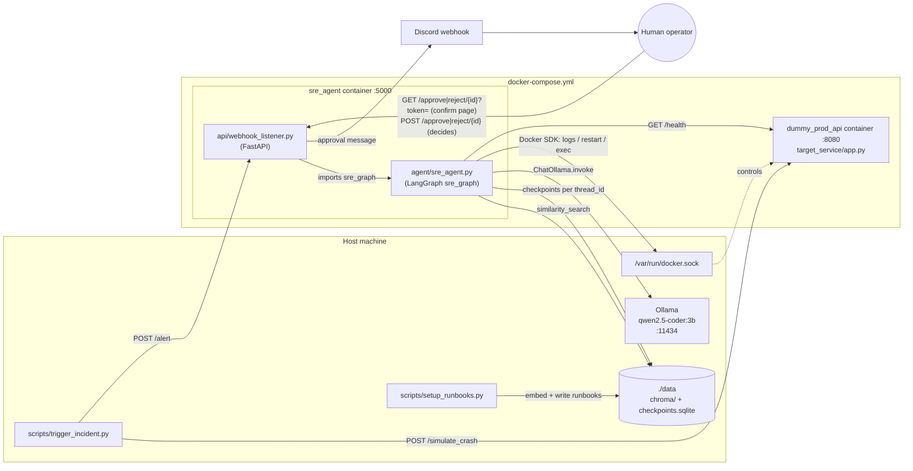
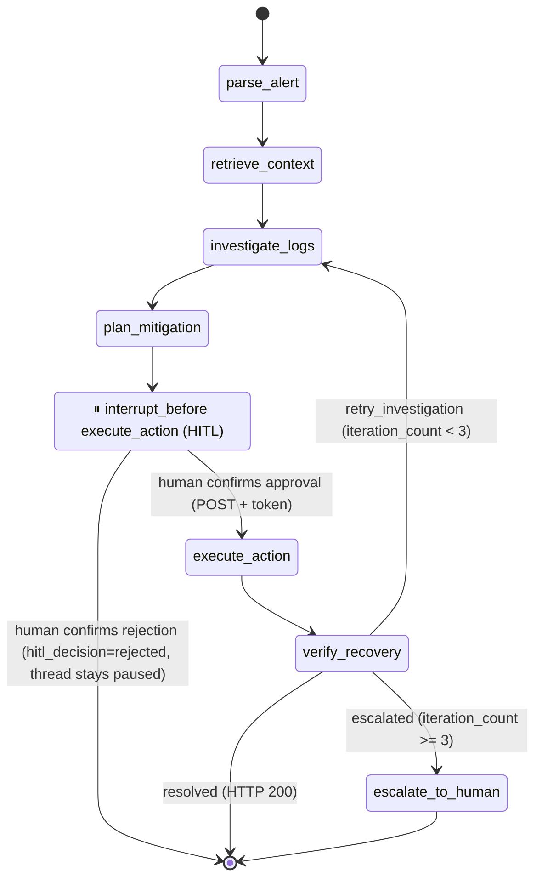

# 🔀 WORKFLOW.md: How the Autonomous SRE Agent Fits Together

This file shows how the parts of the project connect: who calls whom, what data moves between them, and the order things happen during an incident. For the goals and tech stack, see [ARCHITECTURE.md](ARCHITECTURE.md). For the project constraints, see [RULES.md](RULES.md).

---

## 1. Component Map



### File responsibilities

| File | Role | Connects to |
|---|---|---|
| [api/webhook_listener.py](../api/webhook_listener.py) | FastAPI entry point (port 5000). Accepts alerts, runs the graph in background tasks, issues a one-time approval token at each pause, sends the Discord approval message, serves confirmation pages (GET) and records the decision (POST). | `agent.sre_agent.sre_graph`, Discord, `.env` |
| [agent/sre_agent.py](../agent/sre_agent.py) | LangGraph state machine: 7 nodes, a retry router, a SQLite checkpointer and a pause before `execute_action`. Also has a standalone CLI mode. | ChromaDB, Ollama, Docker SDK, target `/health` |
| [target_service/app.py](../target_service/app.py) | The "broken" service. `/health`, `/simulate_crash`, `/recover`. Crash state is kept **in memory**, so a container restart fixes it. | Probed by the agent, crashed by the trigger script |
| [scripts/setup_runbooks.py](../scripts/setup_runbooks.py) | One-time seeding of 2 runbooks into `./data/chroma` (collection `sre_runbooks`). | ChromaDB on disk |
| [scripts/trigger_incident.py](../scripts/trigger_incident.py) | Demo driver: crashes the target, then fires an alert. Uses `localhost` URLs, so it runs on the host. | `:8080/simulate_crash`, `:5000/alert` |
| [tests/test_sre_agent.py](../tests/test_sre_agent.py) | Pytest tests for `execute_action` with Docker mocked. | `agent.sre_agent.execute_action` |
| [docker-compose.yml](../docker-compose.yml) / [Dockerfile](../Dockerfile) | Runs `sre_agent` and `dummy_prod_api`. Mounts `./data` and the Docker socket, and maps `host.docker.internal`. | Host Docker, Ollama |

---

## 2. LangGraph State Machine

Defined in `create_sre_graph()` ([agent/sre_agent.py:392](../agent/sre_agent.py#L392)).



### Nodes

| Node | Reads from state | Writes to state | Side effects |
|---|---|---|---|
| `parse_alert` | `alert_payload` | `service_name`, `status=alert_parsed`, `iteration_count=0` | none. Looks for the service in `service`, then `service_name`, then `incident.service.name`, else `dummy_prod_api` |
| `retrieve_context` | `service_name` | `runbook_context` | ChromaDB `similarity_search(k=2)` |
| `investigate_logs` | `service_name`, `iteration_count`, `container_logs` | `container_logs` (last 20 lines plus earlier `[VERIFICATION FAILURE]` notes), `iteration_count += 1` | Docker `container.logs(tail=20)` |
| `plan_mitigation` | `alert_payload`, `runbook_context`, `container_logs` | `proposed_action` (last line of the LLM output, quotes and backticks removed) | Ollama call. Falls back to `RESTART <service>` on error |
| `execute_action` ⏸ | `proposed_action` | `status=action_executed:…` or `action_failed:…` | Docker `RESTART`, `STOP`, `PAUSE`, `UNPAUSE` or `EXEC` |
| `verify_recovery` | `service_name` | `status=Resolved`, or `Escalated - Restart Failed` with a `[VERIFICATION FAILURE]` note added to `container_logs` | waits 2s, then `GET /health` |
| `escalate_to_human` | `service_name`, `status` | `status=Escalated to Human Operator` | prints a critical banner |

**Router** `check_recovery_status`: returns `resolved` when the status is `Resolved`. Otherwise it returns `retry_investigation` while `iteration_count < 3`, then `escalated`. That allows at most **3 remediation attempts**, and each attempt needs its own human approval.

### State (`AgentState`)

`alert_payload`, `service_name`, `runbook_context`, `container_logs`, `proposed_action`, `status`, `iteration_count`. The SQLite checkpointer (`./data/checkpoints.sqlite`) saves state per `thread_id`, which is what lets the graph pause and resume across HTTP requests.

### How a failed attempt reaches the next prompt

`verify_recovery` adds a `[VERIFICATION FAILURE]` line to `container_logs`. `investigate_logs` fetches fresh logs and keeps those lines. `plan_mitigation`'s **PAST ATTEMPTS** instruction then tells the LLM not to repeat the same action.

---

## 3. End-to-End Incident Flow (Remote HITL via Discord)

```mermaid
sequenceDiagram
    autonumber
    participant T as trigger_incident.py
    participant S as dummy_prod_api :8080
    participant A as webhook_listener :5000
    participant G as sre_graph (LangGraph)
    participant C as ChromaDB
    participant O as Ollama
    participant D as Discord
    participant H as Human

    T->>S: POST /simulate_crash
    S-->>T: 500 (is_crashed=True, CRITICAL logs)
    T->>A: POST /alert {service, severity, issue}
    A-->>T: 202 {thread_id}
    A->>G: BackgroundTask run_agent_workflow(alert, thread_id)
    G->>G: parse_alert
    G->>C: retrieve_context (similarity_search)
    G->>S: investigate_logs (docker logs tail=20)
    G->>O: plan_mitigation (prompt)
    O-->>G: "RESTART dummy_prod_api"
    Note over G: ⏸ interrupt_before execute_action<br/>state checkpointed to SQLite
    A->>G: pause_and_notify: update_state(approval_token, hitl_decision=pending)
    A->>D: notify_discord(thread_id, service, action, token)
    D->>H: message with Review & approve / Review & reject links (?token=…)
    H->>A: GET /approve/{thread_id}?token=… (or /reject)
    A-->>H: confirmation page. Nothing runs yet.
    alt Confirm approval
        H->>A: POST /approve/{thread_id} (form: token)
        A->>G: claim decision under lock → hitl_decision=approved
        A->>G: BackgroundTask resume_agent_workflow → stream(None)
        G->>S: execute_action (container.restart)
        G->>S: verify_recovery GET /health
        S-->>G: 200 → status=Resolved → END
        Note over A,G: If verification fails and the graph pauses again,<br/>pause_and_notify issues a NEW token and notifies Discord again.
    else Confirm rejection
        H->>A: POST /reject/{thread_id} (form: token)
        Note over G: hitl_decision=rejected. Thread stays paused; later approvals get 409.
    end
```

**Approval endpoint rules.** A GET only renders a confirmation page, so link-preview crawlers (Discord fetches links as soon as a message is posted) can't trigger an action. Only a POST with the current token decides.

| Situation | Response |
|---|---|
| Unknown `thread_id` | 404 |
| Missing or wrong token (including an old token from an earlier pause) | 403 |
| Already decided, or the thread isn't paused before `execute_action` | 409 |
| Valid GET | 200 confirmation page (no state change) |
| Valid first POST | 200; approve resumes the graph, reject records `hitl_decision=rejected` |

---

## 4. Entry Points and Run Modes

| Mode | Command | Approval method |
|---|---|---|
| **Full stack (Docker)** | `docker compose up --build`, then `python scripts/trigger_incident.py` from the host | Discord links to `BASE_URL/approve/{id}` |
| **Listener on host** | `python api/webhook_listener.py` (target running via `target_service/docker-compose.yml`) | Discord links |
| **CLI demo** | `python agent/sre_agent.py` (add `--yes` or `-y` to auto-approve) | Terminal `y/n` prompt, repeated for each retry |
| **Tests** | `pytest` | n/a (Docker mocked) |

**Prerequisites (in order):**
1. Ollama running with `qwen2.5-coder:3b` pulled.
2. `python scripts/setup_runbooks.py` run from the project root, which seeds `./data/chroma`.
3. `.env` copied from [.env.example](../.env.example) with `DISCORD_WEBHOOK_URL` and `BASE_URL` set. The listener refuses to start without both.
4. For phone or remote approvals, `BASE_URL` must be a public tunnel (ngrok or localhost.run) to port 5000.

### Environment-dependent addresses

| Setting | Inside the container | On the host |
|---|---|---|
| Ollama (`OLLAMA_BASE_URL`) | `http://host.docker.internal:11434` (set in compose) | same default, so set `OLLAMA_BASE_URL=http://localhost:11434` if needed |
| Health check (`get_healthcheck_url`) | `http://dummy_prod_api:8080/health` (detected via `/.dockerenv`) | `http://localhost:8080/health` |
| Override | `HEALTHCHECK_URL` env var wins in both cases | |

---

## 5. Known Gaps and Inconsistencies (from the scan)

These are things I noticed while tracing the flow. None of them have been changed.

1. ~~**Retries 2 and 3 never notify Discord.**~~ Fixed: `resume_agent_workflow` calls `pause_and_notify`, which issues a new token and sends a new Discord message whenever the graph pauses again.
2. ~~**Reject does not record anything.**~~ Fixed: a confirmed reject sets `hitl_decision=rejected`, and any later approve gets 409.
3. ~~**The approve and reject endpoints have no authentication or one-time use.**~~ Fixed: GET only shows a confirmation page (a live test showed Discord's link-preview crawler hitting both links within a second of posting), POST requires a per-pause `secrets.token_urlsafe(32)` token, and the first decision is final (atomic under a lock). The listener redacts `token=` from uvicorn's access log, caps approval form bodies at 4 KB and `/alert` bodies at 64 KB, and sends `no-store`, `no-referrer`, `X-Frame-Options: DENY` and `nosniff` on every response, plus a strict CSP on everything except FastAPI's `/docs`, `/redoc` and `/openapi.json`. Remaining limits: the token sits in the URL query, so it can still appear in tunnel or proxy logs and browser history; it's stored in plaintext in the local SQLite checkpoint; the decision lock is per process, so run the listener as a single uvicorn worker. A thread whose resume crashes while still paused gets a fresh token and notification. The agent also retries a failed Discord notification once, then logs an "Operator NOT notified" error.
4. **`EXEC` runs LLM-generated shell commands** inside the container. The HITL pause is the only safeguard: there is no allowlist.
5. ~~**`ARCHITECTURE.md` lists `agent/tools.py`**, which doesn't exist.~~ Fixed: the directory tree now matches the repo. The Docker helpers live inside `sre_agent.py`.
6. ~~**The Dockerfile name doesn't match.**~~ Fixed: `dockerfile` was renamed to `Dockerfile`, which matches the reference in `docker-compose.yml`.
7. **Importing `agent.sre_agent` has side effects.** It opens `./data/checkpoints.sqlite` and compiles `sre_graph`, relative to the current directory, so even running tests creates `./data/`.
8. **Paths are relative to where you run from.** `./data/chroma` must be the same directory for `setup_runbooks.py` and the agent, so always run from the project root, or rely on the compose volume.
9. **Test coverage only covers `execute_action`.** There are no tests for the router, `parse_alert`, `verify_recovery` or the listener endpoints.
